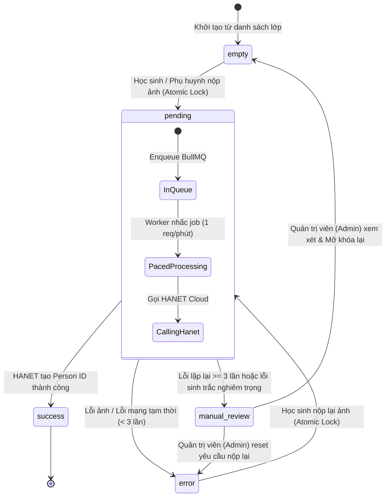

# Data Model: Student Face Registration & Onboarding

Feature: `001-student-face-registration`  
Date: 2026-10-21  
Source of Truth: PostgreSQL 16 (`docker/postgres/init.sql`)

---

## 1. Entities & Attributes

### `classes` (Lớp học)
| Field | Type | Constraints | Description |
| :--- | :--- | :--- | :--- |
| `id` | SERIAL | PRIMARY KEY | Định danh nội bộ lớp học |
| `code` | VARCHAR(50) | UNIQUE, NOT NULL | Mã lớp (VD: '10A1', 'GLV') |
| `name` | VARCHAR(255) | NOT NULL | Tên hiển thị lớp học |
| `department_code` | VARCHAR(20) | DEFAULT '' | Mã phòng ban / khối |
| `teacher_name` | VARCHAR(100) | NULL | Tên giáo viên chủ nhiệm |
| `token` | VARCHAR(100) | NOT NULL | Mã PIN lớp dùng để miễn trừ giới hạn tần suất gửi |
| `is_locked` | BOOLEAN | DEFAULT FALSE | Cờ khóa lớp (từ chối nộp ảnh mới) |
| `created_at` | TIMESTAMPTZ | DEFAULT NOW() | Thời gian tạo |
| `updated_at` | TIMESTAMPTZ | DEFAULT NOW() | Thời gian cập nhật |

### `students` (Học sinh)
| Field | Type | Constraints | Description |
| :--- | :--- | :--- | :--- |
| `id` | SERIAL | PRIMARY KEY | Định danh nội bộ học sinh |
| `class_id` | INT | REFERENCES classes(id) | Lớp học trực thuộc |
| `name` | VARCHAR(255) | NOT NULL | Họ và tên chuẩn tiếng Việt |
| `normalized_name` | VARCHAR(255) | NULL | Tên chuẩn hóa không dấu phục vụ tìm kiếm/đối soát |
| `qr_token` | VARCHAR(32) | UNIQUE, NOT NULL | Chuỗi token URL-safe cố định phục vụ tra cứu |
| `alias_id` | VARCHAR(100) | UNIQUE | Mã định danh chuẩn 9 ký tự (`^[A-Za-z]{2}[A-Za-z0-9]{2}_[A-Za-z0-9]{4}$`) |
| `status` | student_status | DEFAULT 'empty' | Trạng thái máy trạng thái |
| `person_id` | VARCHAR(100) | UNIQUE | Mã định danh khuôn mặt do HANET Cloud cấp |
| `face_url` | TEXT | NULL | Link ảnh trên CDN của HANET Cloud |
| `local_image_path` | TEXT | NULL | Đường dẫn ảnh tạm trên Docker shared volume (`tmp-faces/`) |
| `retry_count` | INT | DEFAULT 0 | Số lần đã retry với worker / HANET |
| `last_error_code` | VARCHAR(50) | NULL | Mã lỗi gần nhất (VD: '-503', '-9008') |
| `last_error_message` | TEXT | NULL | Thông báo lỗi chi tiết |
| `created_at` | TIMESTAMPTZ | DEFAULT NOW() | Thời gian tạo |
| `updated_at` | TIMESTAMPTZ | DEFAULT NOW() | Thời gian cập nhật |

### `settings` (Cấu hình hệ thống & Chốt chặn khẩn cấp)
| Field | Type | Constraints | Description |
| :--- | :--- | :--- | :--- |
| `key` | VARCHAR(50) | PRIMARY KEY | Khóa cấu hình (`registration_enabled`, `hanet_sync_rate_limit`) |
| `value` | TEXT | NOT NULL | Giá trị tham số |

*Cấu hình cốt lõi*:
- `registration_enabled`: `'true'` / `'false'` (Chốt chặn toàn trường - Global Kill-Switch).
- `hanet_sync_rate_limit`: `'1'` (Nhịp gọi API HANET: 1 request/phút).

### `logs` (Nhật ký kiểm toán)
| Field | Type | Constraints | Description |
| :--- | :--- | :--- | :--- |
| `id` | BIGSERIAL | PRIMARY KEY | ID nhật ký |
| `student_id` | INT | REFERENCES students(id) | ID học sinh liên quan |
| `alias_id` | VARCHAR(64) | NULL | Mã 9 ký tự tại thời điểm ghi log |
| `action` | VARCHAR(50) | NOT NULL | Hành động (`REGISTER`, `UPDATE_PHOTO`, `RETRY`, `ADMIN_UNLOCK`) |
| `result_code` | VARCHAR(50) | NOT NULL | Kết quả (`SUCCESS`, `ERROR`, `REJECTED`, `CONFLICT`) |
| `result_message` | TEXT | NULL | Ghi chú chi tiết kết quả |
| `ip` | VARCHAR(45) | NULL | Địa chỉ IP client (IPv4/IPv6) |
| `created_at` | TIMESTAMPTZ | DEFAULT NOW() | Thời điểm ghi nhận |

---

## 2. Máy Trạng thái Vòng đời Học sinh (Lifecycle State Machine)



### Quy tắc chuyển đổi trạng thái (Transition Invariants):
1. **Cổng nộp ảnh công khai (Học sinh/Phụ huynh)**:
   - **ĐƯỢC PHÉP**: `empty` → `pending`, `error` → `pending`.
   - **BỊ CẤM (Trả về HTTP 409 Conflict)**: `pending` → `pending`, `success` → `pending`, `manual_review` → `pending`.
2. **Quyền Quản trị viên (Admin API: `POST /api/admin/students/:id/unlock` theo `contracts/admin-api.yaml`)**:
   - Được phép chuyển `manual_review` → `empty` hoặc `error` để giải phóng hồ sơ cho học sinh nộp lại.
   - Ghi nhận nhật ký kiểm toán trong bảng `logs` với hành động `ADMIN_UNLOCK`.
3. **Tuổi thọ trạng thái `pending`**:
   - `pending` **KHÔNG HẾT HẠN**. Tác vụ nằm an toàn trong Redis queue và được xử lý tuần tự theo nhịp 1 req/phút.

---

## 3. Câu lệnh Khóa Nguyên tử (Atomic SQL Mechanics)

Thực hiện trong `apps/api/src/services/registration.ts`:

```sql
UPDATE students
SET 
  status = 'pending',
  local_image_path = :localImagePath,
  retry_count = 0,
  updated_at = NOW()
WHERE id = :studentId 
  AND status IN ('empty', 'error')
RETURNING id, alias_id, name, class_id, status;
```
- Nếu trả về 0 dòng → Ném lỗi `409 Conflict: Hồ sơ đang trong hàng đợi xử lý hoặc không ở trạng thái được phép nộp ảnh`.
